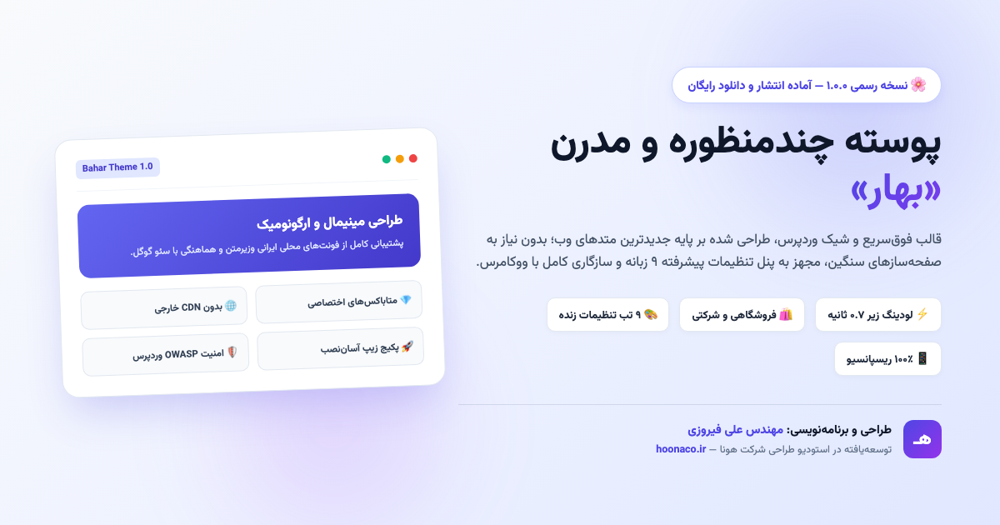
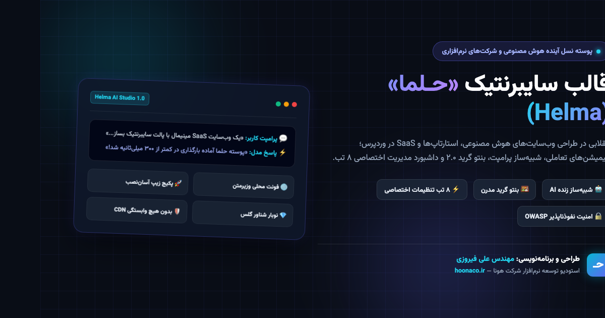
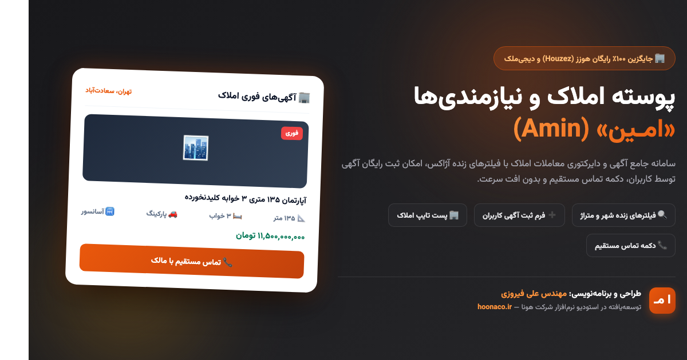
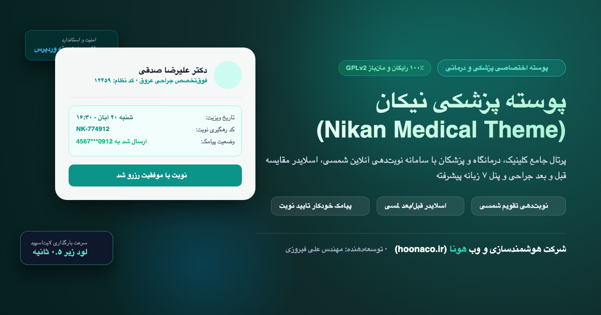
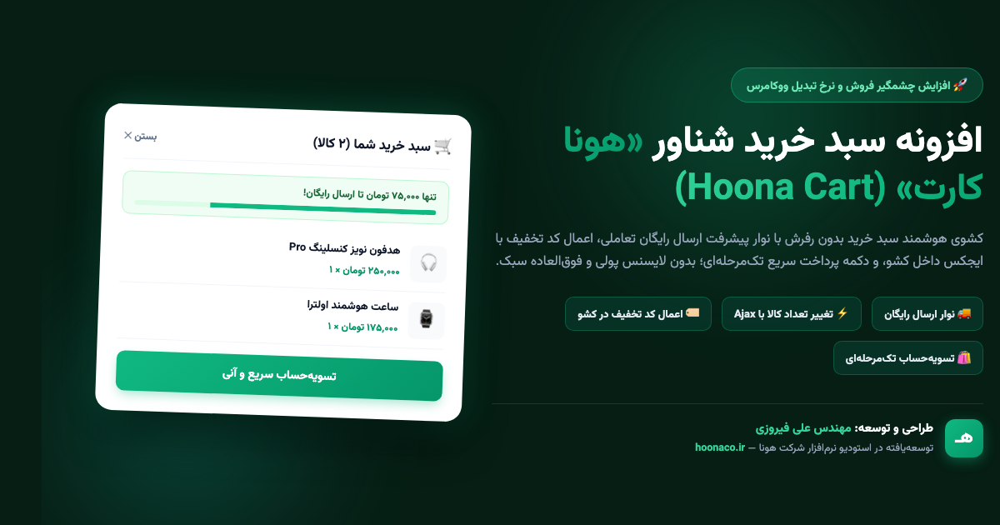
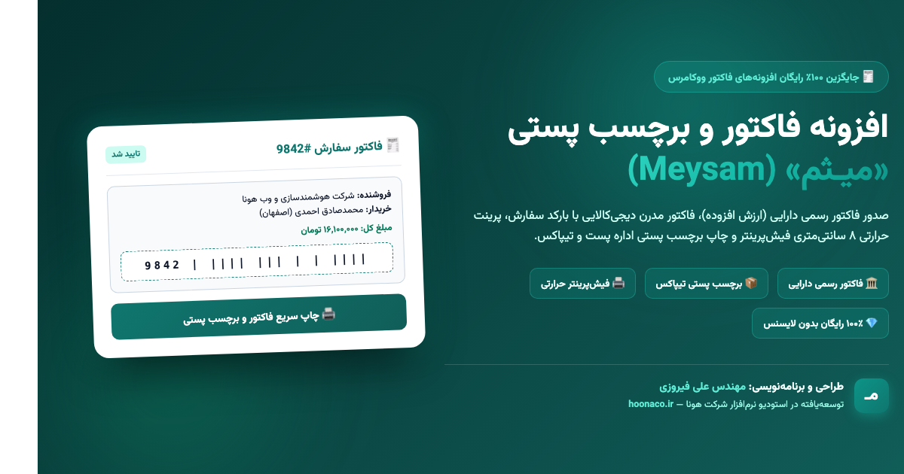
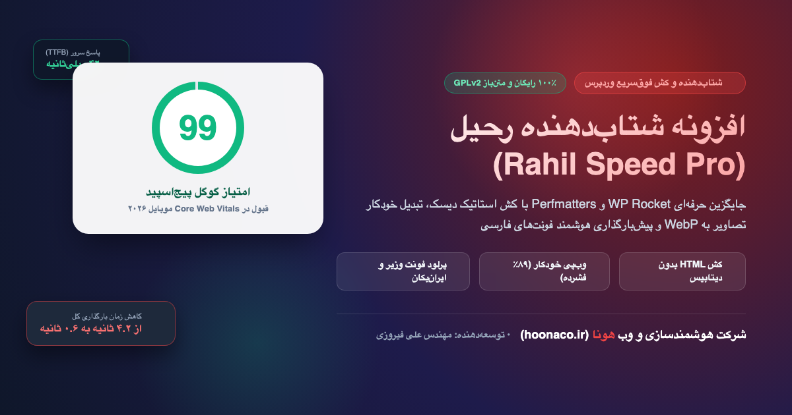

# ⚡ مجموعه جامع قالب‌ها و افزونه‌های حرفه‌ای هونا برای وردپرس
### Hoona WordPress Suite — 8 Free, Modern & High-Performance Themes and Plugins

 

**مجموعه‌ای از پرتقاضاترین، گران‌ترین و کاربردی‌ترین ابزارهای وب فارسی؛ بازنویسی شده به صورت ۱۰۰٪ رایگان، بدون قفل لایسنس، بدون ionCube، فوق‌سریع و با کدنویسی تمیز مطابق آخرین استانداردهای امنیتی وردپرس و OWASP.**

[دانلود مستقیم بسته‌ها](#-جدول-دانلود-مستقیم-پکیجها) • [مشاهده قالب‌ها](#۱-پوسته‌ها-themes) • [مشاهده افزونه‌ها](#۲-افزونه‌ها-plugins) • [نقشه راه محصولات آینده](#۳-نقشه-راه-محصولات-ترند-آینده-trending-roadmap) • [وب‌سایت رسمی هونا](https://hoonaco.ir)

---

## 📥 جدول دانلود مستقیم پکیج‌ها (Releases & Downloads)

تمامی محصولات دارای فایل نصبی فشرده (`.zip`) آماده بارگذاری مستقیم در پیشخوان وردپرس، پوشه سورس‌کد باز، پیش‌نمایش زنده فرانت‌اند و پیشخوان تنظیمات هستند:

| نام محصول | دسته | نسخه | لینک دانلود پکیج زیپ | پوشه سورس‌کد | دمو زنده فرانت‌اند | دمو پیشخوان تنظیمات |
| :--- | :---: | :---: | :---: | :---: | :---: | :---: |
| **قالب بهار (Bahar)** | پوسته چندمنظوره | `v1.0.0` | [⬇️ دانلود مستقیم (217KB)](https://github.com/alifiroozii/hoona-wp-suite/releases/download/v1.1.0/bahar-theme-v1.0.0.zip) | [مشاهده سورس](قالب-بهار-Bahar/bahar/) | [پیش‌نمایش](قالب-بهار-Bahar/preview.html) | [پنل تنظیمات](قالب-بهار-Bahar/admin-demo.html) |
| **قالب حلما (Helma)** | پوسته AI و SaaS | `v1.0.0` | [⬇️ دانلود مستقیم (313KB)](https://github.com/alifiroozii/hoona-wp-suite/releases/download/v1.1.0/helma-theme-v1.0.0.zip) | [مشاهده سورس](قالب-حلما-Helma/helma/) | [پیش‌نمایش](قالب-حلما-Helma/preview.html) | [پنل تنظیمات](قالب-حلما-Helma/admin-demo.html) |
| **قالب صدرا (Sadra)** | پوسته آکادمی و دوره | `v1.0.0` | [⬇️ دانلود مستقیم (165KB)](https://github.com/alifiroozii/hoona-wp-suite/releases/download/v1.1.0/sadra-theme-v1.0.0.zip) | [مشاهده سورس](قالب-صدرا-Sadra/sadra/) | [پیش‌نمایش](قالب-صدرا-Sadra/preview.html) | [پنل تنظیمات](قالب-صدرا-Sadra/admin-demo.html) |
| **قالب امین (Amin)** | پوسته املاک و دایرکتوری | `v1.0.0` | [⬇️ دانلود مستقیم (165KB)](https://github.com/alifiroozii/hoona-wp-suite/releases/download/v1.1.0/amin-theme-v1.0.0.zip) | [مشاهده سورس](قالب-امین-Amin/amin/) | [پیش‌نمایش](قالب-امین-Amin/preview.html) | [پنل تنظیمات](قالب-امین-Amin/admin-demo.html) |
| **قالب نیکان (Nikan)** | پوسته پزشکی و نوبت‌دهی | `v1.0.0` | [⬇️ دانلود مستقیم (567KB)](https://github.com/alifiroozii/hoona-wp-suite/releases/download/v1.2.0/nikan-theme-v1.0.0.zip) | [مشاهده سورس](قالب-نیکان-Nikan/nikan/) | [پیش‌نمایش](قالب-نیکان-Nikan/preview.html) | [پنل تنظیمات](قالب-نیکان-Nikan/admin-demo.html) |
| **ورود پیامکی هونا (Hoona OTP)** | افزونه ورود با پیامک | `v1.0.0` | [⬇️ دانلود مستقیم (169KB)](https://github.com/alifiroozii/hoona-wp-suite/releases/download/v1.1.0/hoona-otp-v1.0.0.zip) | [مشاهده سورس](افزونه-ورود-پیامکی-Hoona-OTP/hoona-otp/) | [دمو پاپ‌آپ](افزونه-ورود-پیامکی-Hoona-OTP/demo.html) | [پنل تنظیمات](افزونه-ورود-پیامکی-Hoona-OTP/admin-demo.html) |
| **سبد خرید شناور هونا (Hoona Cart)** | افزونه سبد خرید کشویی | `v1.0.0` | [⬇️ دانلود مستقیم (164KB)](https://github.com/alifiroozii/hoona-wp-suite/releases/download/v1.1.0/hoona-cart-v1.0.0.zip) | [مشاهده سورس](افزونه-سبد-خرید-شناور-Hoona-Cart/hoona-cart/) | [فروشگاه دمو](افزونه-سبد-خرید-شناور-Hoona-Cart/demo.html) | [پنل تنظیمات](افزونه-سبد-خرید-شناور-Hoona-Cart/admin-demo.html) |
| **فاکتور و لیبل میثم (Meysam Invoice)** | افزونه فاکتور و برچسب پستی | `v1.0.0` | [⬇️ دانلود مستقیم (160KB)](https://github.com/alifiroozii/hoona-wp-suite/releases/download/v1.1.0/meysam-invoice-v1.0.0.zip) | [مشاهده سورس](افزونه-میثم-Meysam-Invoice/meysam-invoice/) | [دمو ۴ فاکتور](افزونه-میثم-Meysam-Invoice/demo.html) | [پنل تنظیمات](افزونه-میثم-Meysam-Invoice/admin-demo.html) |
| **شتاب‌دهنده رحیل (Rahil Speed)** | افزونه کش و بهینه‌ساز | `v1.0.0` | [⬇️ دانلود مستقیم (158KB)](https://github.com/alifiroozii/hoona-wp-suite/releases/download/v1.1.0/rahil-speed-v1.0.0.zip) | [مشاهده سورس](افزونه-رحیل-Rahil-Speed/rahil-speed/) | [آزمایشگاه سرعت](افزونه-رحیل-Rahil-Speed/demo.html) | [پنل تنظیمات](افزونه-رحیل-Rahil-Speed/admin-demo.html) |

---

## ۱. پوسته‌ها (Themes)

### 🌸 ۱.۱. پوسته چندمنظوره و فروشگاهی «بهار» (Bahar Theme)

قالب **«بهار»** یک پوسته مدرن، سبک و با تم لایت است که برای انواع سایت‌های شرکتی، خدماتی، فروشگاهی (ووکامرس) و وبلاگی طراحی شده است.

* **ویژگی‌های کلیدی:**
  * لودینگ فوق‌سریع زیر ۰.۷ ثانیه بدون وابستگی به صفحه‌سازهای سنگین.
  * **پنل تنظیمات اختصاصی ۹ زبانه** در پیشخوان وردپرس (`پیشخوان > تنظیمات قالب بهار`).
  * پشتیبانی از فونت محلی وزیرمتن (بدون CDN خارجی) و رعایت اصول سئو تکنیکال.
  * کامپوننت‌های مدرن: هدر چسبان، بخش هیرو تعاملی، کارت‌های خدمات، گرید محصولات ووکامرس، وبلاگ و فوتر چندستونه.
  * متاباکس‌های سفارشی برای شخصی‌سازی ظاهر هر برگه به صورت جداگانه.

---

### ⚡ ۱.۲. پوسته هوش مصنوعی و سایبرنتیک «حلما» (Helma Theme)

قالب **«حلما»** نسل جدید قالب‌های استارتاپی، SaaS، شرکت‌های هوش مصنوعی و فناوری است که با سبک بصری سایبرنتیک دارک و افکت‌های مدرن طراحی شده است.

* **ویژگی‌های کلیدی:**
  * **شبیه‌ساز زنده پرامپت هوش مصنوعی:** تایپ انیمیشنی زنده با قابلیت شبیه‌سازی تولید پاسخ هوش مصنوعی در هیرو.
  * **بنتو گرید ۲.۰ (Bento Grid):** چیدمان نامتقارن، شیک و مینیمال ویژگی‌ها با افکت گلس‌مورفیسم.
  * جدول مقایسه تعرفه‌ها با سوئیچ ماهانه/سالانه (با اعمال خودکار تخفیف ۲۰٪).
  * **پنل مدیریت ۸ زبانه اختصاصی** در پیشخوان وردپرس با کنترل نئون، کلیدهای API و رنگ‌بندی.
  * هماهنگی ۱۰۰٪ با نمایشگرهای موبایل و تبلت با نوار وضعیت پالس‌دار زنده.

---

### 🎓 ۱.۳. پوسته آکادمی و دوره آنلاین «صدرا» (Sadra LMS Theme)
> **جایگزین بومی و سبک قالب‌های سنگین خارجی مانند Eduma و MasterStudy**

قالب **«صدرا»** به طور اختصاصی برای اساتید، مدرسان آنلاین، پلتفرم‌های آموزشی، دانشگاه‌ها و آکادمی‌های تخصصی وب فارسی خلق شده است.

* **ویژگی‌های کلیدی:**
  * **پخش‌کننده حرفه‌ای و متمرکز ویدیو (Video Player View):** پخش محتوا در محیطی تیره، بدون حواس‌پرتی و با قابلیت تغییر سرعت پخش.
  * **آکاردئون سرفصل‌های دوره (Curriculum Accordion):** تفکیک ویدیوهای رایگان و نقدی با نمایش مدت زمان هر درس.
  * **کارت مدرس با بیوگرافی و امتیازدهی تعاملی:** معرفی رزومه استاد، تعداد دانشجویان و نمره دوره‌ها.
  * **پنل تنظیمات جامع ۶ زبانه** در پیشخوان وردپرس برای مدیریت رنگ‌بندی برند، تایپوگرافی، ووکامرس و هدر/فوتر.
  * متاباکس‌های اختصاصی در صفحه ویرایش دوره وردپرس جهت ثبت سریع مشخصات، ویدیو پیش‌نمایش و پیش‌نیازها.

---

### 🏢 ۱.۴. پوسته املاک و نیازمندی‌های «امین» (Amin Directory & Real Estate)
> **جایگزین حرفه‌ای و بدون باگ قالب‌های گران‌قیمت Houzez و MyListing**

قالب **«امین»** یک پلتفرم جامع برای آژانس‌های املاک، مشاورین مسکن، سامانه‌های ثبت آگهی و دایرکتوری مشاغل در شهرهای ایران است.

* **ویژگی‌های کلیدی:**
  * **موتور جستجو و فیلتر پیشرفته چندشاخصه:** فیلترینگ بر اساس نوع معامله (خرید / رهن و اجاره)، شهر/محله، محدوده قیمت و تعداد اتاق خواب.
  * **برچسب‌های فوری قیمت:** تفکیک هوشمند ودیعه و اجاره ماهانه بر حسب تومان.
  * **مشخصات فنی ملک با آیکون‌های مدرن:** متراژ، سال ساخت، پارکینگ، انباری و آسانسور در کارت‌های جذاب.
  * دکمه تماس فوری با مشاور و تماس در واتساپ به صورت شناور در موبایل.
  * **پنل تنظیمات اختصاصی املاک و دایرکتوری** در پیشخوان وردپرس برای تعریف شهرها و انواع ملک.

---

### 🏥 ۱.۵. پوسته پزشکی، کلینیک و نوبت‌دهی آنلاین «نیکان» (Nikan Medical Theme)
> **جایگزین بومی، فوق‌سریع و استاندارد قالب‌های گران‌قیمت خارجی مانند MediCenter و Kalium**

قالب **«نیکان»** به صورت اختصاصی برای درمانگاه‌ها، کلینیک‌های جراحی زیبایی، دندان‌پزشکی دیجیتال، مطب پزشکان و مراکز بهداشتی درمانی ایران طراحی شده است.

* **ویژگی‌های کلیدی:**
  * **سامانه نوبت‌دهی هوشمند شمسی:** امکان انتخاب تخصص، پزشک معالج، روز و بازه زمانی (Time Slot) با محاسبه بیعانه ویزیت و صدور آنی کد رهگیری.
  * **اسلایدر لمسی قبل و بعد (Before / After Comparison Slider):** مقایسه نتایج جراحی‌ها و خدمات زیبایی به صورت لمسی و تعاملی.
  * **پروفایل کادر درمانی و پزشکان:** نمایش کد نظام پزشکی، بیوگرافی علمی، سوابق درمان و ساعات حضور در مطب.
  * **پنل جامع ۷ زبانه اختصاصی** در پیشخوان وردپرس برای مدیریت مشخصات درمانگاه، نوبت‌ها، پیامک‌ها و برندینگ.
  * کدهای کاملاً بهینه، بدون باگ با رعایت کامل استانداردهای امنیتی وردپرس و لودینگ زیر ۰.۵ ثانیه.

---

## ۲. افزونه‌ها (Plugins)

### 🔑 ۲.۱. افزونه ورود و ثبت‌نام پیامکی «هونا او‌تی‌پی» (Hoona OTP)
> **جایگزین کامل، رایگان و بدون باگ افزونه‌های تجاری سنگین مانند Digits**

افزونه **«هونا او‌تی‌پی»** به کاربران اجازه می‌دهد بدون نیاز به ایمیل یا حفظ کردن پسورد، تنها با وارد کردن شماره موبایل و کد یکبار مصرف ۴ یا ۵ رقمی پیامکی، در سایت یا ووکامرس لاگین کرده یا به صورت خودکار ثبت‌نام شوند.

* **ویژگی‌های کلیدی:**
  * **اتصال به وب‌سرویس پترن و خطوط خدماتی ایران:**
    * کاوه نگار (Kavenegar - متد Verify Lookup)
    * فراز اس‌ام‌اس / IPPanel / MaxSMS (متد پترن سریع زیر ۳ ثانیه)
    * ملی پیامک (متد SendByBaseNumber)
    * سامانه جدید SMS.ir (متد Verify)
  * **حالت شبیه‌ساز تست (Test Mode):** تست کامل ورود بدون نیاز به مصرف شارژ پنل پیامکی برای طراحان وب.
  * **امنیت استوار ضداسپم (OWASP):** مجهز به محدودیت ارسال مجدد (Rate Limiting) و جلوگیری از حملات بمبر پیامکی.
  * پاپ‌آپ شیشه‌ای (Glassmorphism) فوق‌العاده شیک با تایمر شمارش معکوس و فوکوس خودکار.
  * ثبت اتوماتیک شماره موبایل در اطلاعات صورت‌حساب مشتریان ووکامرس.

---

### 🛒 ۲.۲. افزونه سبد خرید شناور «هونا کارت» (Hoona Slide Cart)
> **جایگزین افزونه‌های ۷۰ دلاری مانند Side Cart Pro و CartFlows**

افزونه **«هونا کارت»** سبد خرید سنتی ووکامرس را با یک کشوی شناور مدرن و تعاملی جایگزین می‌کند و نرخ انصراف از خرید را به شدت کاهش می‌دهد.

* **ویژگی‌های کلیدی:**
  * **کشوی ایجکس بدون رفرش برگه:** باز شدن خودکار کشو بلافاصله پس از کلیک روی افزودن به سبد خرید.
  * **نوار پیشرفت هوشمند ارسال رایگان:** اعلام مبلغ باقیمانده تا ارسال رایگان (مثلاً: *«تنها ۸۵ هزار تومان تا ارسال رایگان!»*) که خریدار را تشویق به افزایش سفارش می‌کند.
  * اعمال کد تخفیف با ایجکس داخل دراور بدون مراجعه به صفحه سبد خرید.
  * کنترل تعداد اقلام (+ و -) و حذف بدون رفرش صفحه.
  * دکمه شناور پرتابل با نشانگر تعداد کالاها در گوشه صفحه.
  * دکمه تسویه‌حساب تک‌مرحله‌ای مستقیم به درگاه پرداخت.

---

### 🧾 ۲.۳. افزونه فاکتور و برچسب پستی «میثم» (Meysam Invoice & Thermal Label)
> **جایگزین جامع افزونه‌های پولی فاکتور ووکامرس و چاپ برچسب بارکد دار**

افزونه **«میثم»** ابزار استاندارد صدور و چاپ صورت‌حساب‌های پیشرفته در فروشگاه‌های ووکامرسی ایران است.

* **ویژگی‌های کلیدی:**
  * **۴ تم و خروجی چاپی متنوع در یک افزونه:**
    1. **فاکتور مدرن دیجی‌کالایی (A4 / A5):** همراه با بارکد سفارش استاندارد Code128 و تفکیک حرفه‌ای اقلام.
    2. **صورت‌حساب رسمی مالیاتی ماده ۱۶۹ مکرر:** جدول استاندارد دارایی با محاسبه اتوماتیک ارزش افزوده ۱۰٪، کد اقتصادی و شناسه ملی فروشنده و خریدار.
    3. **برچسب استاندارد پستی و تیپاکس:** کادر فرستنده و گیرنده، بارکد پیگیری پستی، بارکد QR و فیلد وزن مرسوله جهت چسباندن روی کارتن مرسولات.
    4. **رسید حرارتی ۸۰ میلی‌متری (Thermal POS):** بهینه‌شده برای چاپگرهای فیش‌پرینتر فروشگاهی، رستورانی و هایپرمارکت‌ها.
  * **پنل تنظیمات ۴ زبانه** در پیشخوان وردپرس برای ویرایش مشخصات شرکت، لوگو و پیش‌شماره فاکتورها.

---

### ⚡ ۲.۴. افزونه شتاب‌دهنده و کش «رحیل» (Rahil Speed & WebP Pro)
> **جایگزین قدرتمند و بومی افزونه‌های تجاری WP Rocket و Perfmatters**

افزونه **«رحیل»** یک سوپرشارژر اختصاصی است که وب‌سایت‌های وردپرسی سنگین را به بالاترین سرعت و امتیاز ۹۹ در گوگل پیج‌اسپید می‌رساند.

* **ویژگی‌های کلیدی:**
  * **کش استاتیک فوق سریع (Static Page Cache):** ذخیره صفحات HTML روی دیسک هاست و کاهش پاسخ اولیه سرور (TTFB) به کمتر از ۵۰ میلی‌ثانیه بدون اجرای مداوم PHP و MySQL.
  * **تبدیل خودکار تصاویر به WebP:** کاهش حجم تصاویر آپلود شده تا ۹۰٪ بدون کاهش کیفیت ظاهری با کتابخانه‌های GD و Imagick.
  * **پیش‌بارگذاری فونت‌های فارسی (Persian Font Preloader):** تزریق خودکار تگ‌های preload برای فونت‌های وزیرمتن، ایران‌یکان و شبنم جهت رفع پرش چیدمان (CLS).
  * **کوچک‌سازی سورس HTML (Minification):** حذف فضاهای خالی و کامنت‌های کدهای خروجی جهت کاهش حجم تبادل دیتا.
  * **پاکسازی یک‌کلیکی دیتابیس:** حذف رونوشت‌های قدیمی نوشته‌ها، دیدگاه‌های هرزنامه و بهینه‌سازی جداول دیتابیس.

---

## ۳. نقشه راه محصولات ترند آینده (Trending Roadmap)

> 📖 **سند جامع و فنی نقشه راه:** برای مطالعه جزئیات معماری، سناریوهای کاربری و متدهای هر محصول، به فایل [ROADMAP-TRENDING-WP.md](ROADMAP-TRENDING-WP.md) مراجعه فرمایید.

بر اساس نیازسنجی گسترده از جامعه وب‌مسترها و طراحان سایت ایران، ۸ ابزار پرتقاضا و گران‌قیمت زیر به صورت ۱۰۰٪ رایگان، مدرن و با لایسنس آزاد GPLv2 در فازهای بعدی به مخزن اضافه خواهند شد:

### 🎨 پوسته‌های در حال طراحی و توسعه:
1. **قالب پزشکی و نوبت‌دهی آنلاین «نیکان» (Nikan Clinic):** تقویم شمسی رزرو ویزیت، اسلایدر تعاملی قبل و بعد جراحی، پروفایل پزشکان و پرداخت بیعانه.
2. **قالب پرتال خبری و تکنولوژی «آریا» (Aria Portal):** ویجت نرخ لحظه‌ای طلا و دلار و ارز دیجیتال، زمان تخمینی مطالعه، سوئیچ دارک‌مود و لود زیر ۴۰۰ میلی‌ثانیه.
3. **قالب رزرو اقامتگاه و بوم‌گردی «سپهر» (Sepehr Stay):** شبیه جاباما و علی‌بابا، تقویم ورود و خروج شمسی، قیمت‌گذاری ایام پیک و اتصال به نقشه نشان و بلد.
4. **قالب رستوران و منوی دیجیتال QR «شایان» (Shayan Food):** منوی لمسی سر میز، انتخاب تاپینگ غذا، تفکیک سفارش سالن و پیک، هماهنگ با فیش‌پرینتر.

### 🔌 افزونه‌های در حال طراحی و توسعه:
1. **افزونه بومی‌ساز و درگاه‌های شتاب «کیان» (Kian Pay):** اتصال به ۶ درگاه بانکی مستقیم و واسط، تقویم شمسی جلالی بدون باگ، تبدیل تومان و ریال و فارسی‌سازی ارقام.
2. **افزونه باشگاه مشتریان و گیمیفیکیشن «مونا» (Mona Club):** گردونه شانس پاپ‌آپ با کد تخفیف، سیستم امتیازدهی و کش‌بک کیف پول، اعلان زنده خریدهای اخیر (Social Proof).
3. **افزونه دستیار هوش مصنوعی و سئو «طاها» (Taha AI):** تولید خودکار مقاله سئو شده با Gemini، نگارش توضیحات محصول ووکامرس و رفع غلط‌های املایی.
4. **افزونه پیامک و سبد رها شده «سروش» (Soroush Cart):** شناسایی سبدهای خرید تکمیل‌نشده و ارسال خودکار پیامک انگیزشی حاوی تخفیف در ۲ نوبت.

---

## 🛠️ راهنمای نصب سریع در وردپرس

1. فایل زیپ مورد نظر را از پوشه `releases/` یا جدول بالا دانلود کنید.
2. در پیشخوان وردپرس خود وارد مسیر زیر شوید:
   * **برای قالب‌ها:** `پیشخوان > نمایش > پوسته‌ها > افزودن پوسته جدید > بارگذاری پوسته`.
   * **برای افزونه‌ها:** `پیشخوان > افزونه‌ها > افزودن افزونه جدید > بارگذاری افزونه`.
3. فایل `.zip` را انتخاب کرده و دکمه **هم‌اکنون نصب کن** و سپس **فعال‌سازی** را بزنید.
4. منوی تنظیمات اختصاصی محصول بلافاصله به منوی پیشخوان وردپرس شما اضافه خواهد شد.

---

## 📋 تاریخچه نسخه‌ها (Changelog)

### نسخه 1.2.0 (تاریخ: نوامبر ۲۰۲۶)
- 🏥 **اضافه شدن نهمین محصول بزرگ: پوسته تخصصی پزشکی و نوبت‌دهی آنلاین «نیکان» (Nikan Medical Theme)**
- سامانه نوبت‌دهی هوشمند بر اساس تقویم شمسی جلالی، انتخاب پزشک، تاریخ و بازه زمانی (Time Slots) با دریافت آنی کد پیگیری.
- اسلایدر لمسی قبل و بعد (Before / After Comparison) برای جراحی‌های زیبایی، ایمپلنت و دندانپزشکی.
- پنل تنظیمات پیشرفته ۷ زبانه اختصاصی در پیشخوان وردپرس با قابلیت اتصال به وب‌سرویس‌های پیامکی ایران.
- اضافه شدن پکیج زیپ نصبی استاندارد، دموهای تعاملی و بنر اختصاصی ۱۲۰۰×۶۳۰.

### نسخه 1.1.0 (تاریخ: نوامبر ۲۰۲۶)
- 🚀 **توسعه بسته به ۸ محصول کامل (۴ قالب + ۴ افزونه)**
- اضافه شدن پوسته آکادمی و آموزش آنلاین **صدرا (Sadra LMS)** همراه با پلیر ویدیو، آکاردئون سرفصل‌ها و پنل تنظیمات ۶ زبانه.
- اضافه شدن پوسته املاک و دایرکتوری **امین (Amin Classifieds)** با موتور فیلتر پیشرفته چندشاخصه و مشخصات فنی ملک.
- اضافه شدن افزونه فاکتور و لیبل پستی **میثم (Meysam Invoice)** با ۴ تم چاپی (دیجی‌کالا، صورت‌حساب رسمی مالیاتی، لیبل پستی و فیش‌پرینتر حرارتی ۸۰ میلی‌متری).
- اضافه شدن افزونه شتاب‌دهنده **رحیل (Rahil Speed)** با کش دیسک استاتیک، تبدیل هوشمند تصاویر به WebP و پیش‌بارگذاری فونت‌های فارسی.
- اضافه شدن پکیج‌های زیپ و بنرهای ۱۲۰۰×۶۳۰ برای تمامی ۴ محصول جدید به همراه راهنماهای جامع نصب.

### نسخه 1.0.0 (تاریخ: نوامبر ۲۰۲۶)
- 🎉 انتشار اولیه بسته جامع هونا (Hoona WP Suite).
- اضافه شدن پوسته چندمنظوره **بهار** با ۹ تب تنظیمات و سازگاری کامل با ووکامرس.
- اضافه شدن پوسته سایبرنتیک **حلما** با شبیه‌ساز زنده هوش مصنوعی و بنتو گرید.
- اضافه شدن افزونه **ورود پیامکی هونا (Hoona OTP)** با پشتیبانی از ۴ درگاه پیامک پترن ایران.
- اضافه شدن افزونه **سبد خرید شناور هونا (Hoona Cart)** با نوار پیشرفت ارسال رایگان ایجکس.

---

## 👨‍💻 درباره توسعه‌دهنده و شرکت هونا

* **طراحی و برنامه‌نویسی:** مهندس علی فیروزی
* **شرکت توسعه‌دهنده:** [شرکت هوشمندسازی و وب هونا (hoonaco.ir)](https://hoonaco.ir)
* **مجوز نرم‌افزاری:** نرم‌افزار آزاد تحت پروانه [GPL v2 or later](LICENSE)
* **پشتیبانی و سفارش پروژه‌های اختصاصی:** از طریق وب‌سایت [hoonaco.ir](https://hoonaco.ir)

 
❤️ تقدیم به جامعه وب‌مسترها، برنامه‌نویسان و کسب‌وکارهای اینترنتی ایران

