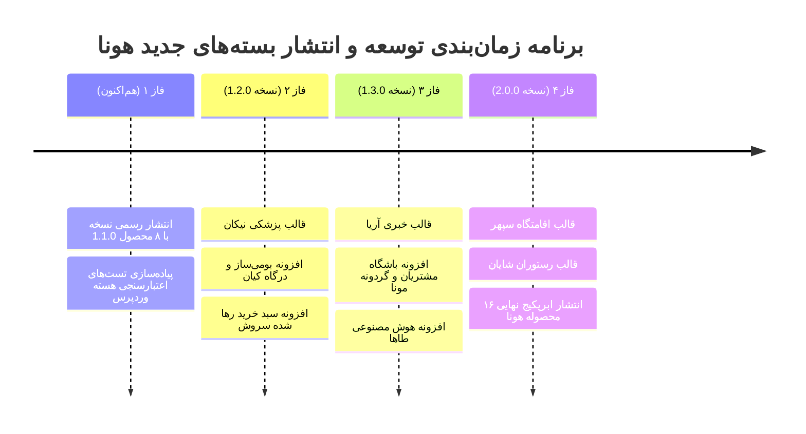

# 🚀 سند راهبردی و نقشه راه محصولات ترند و ویروسی هونا
## Hoona WordPress Suite — Next-Gen Trending Themes & Plugins Roadmap

 

این سند حاصل تحلیل دقیق بازار وب ایران، نیازسنجی طراحان سایت و وب‌مسترها، و شناسایی گران‌ترین ابزارهایی است که در مارکت‌پلیس‌های داخلی (ژاکت، راست‌چین و ...) به مبالغ بالا و همراه با قفل‌های سنگین به فروش می‌رسند. مجموعه هونا قصد دارد این محصولات را به صورت ۱۰۰٪ رایگان، متن‌باز و با استانداردهای نوین بین‌المللی عرضه کند.

---

## 📑 فهرست مطالب
1. [خلاصه وضعیت فعلی (نسخه ۱.۱.۰)](#۱-خلاصه-وضعیت-فعلی-نسخه-۱۱۰)
2. [تحلیل تقاضا و رفتار بازار وب فارسی](#۲-تحلیل-تقاضا-و-رفتار-بازار-وب-فارسی)
3. [پوسته‌های ترند و پرتقاضای پیشنهادی](#۳-پوسته‌های-ترند-و-پرتقاضای-پیشنهادی)
   - [۳.۱. قالب پزشکی، کلینیک و نوبت‌دهی آنلاین «نیکان»](#۳۱-قالب-پزشکی-کلینیک-و-نوبتدهی-آنلاین-نیکان-nikan-clinic)
   - [۳.۲. قالب پرتال خبری، مجله اینترنتی و تکنولوژی «آریا»](#۳۲-قالب-پرتال-خبری-مجله-اینترنتی-و-تکنولوژی-آریا-aria-portal)
   - [۳.۳. قالب رزرو ویلا، بوم‌گردی و اقامتگاه «سپهر»](#۳۳-قالب-رزرو-ویلا-بومگردی-و-اقامتگاه-سپهر-sepehr-stay)
   - [۳.۴. قالب رستوران، کافه و منوی دیجیتال QR «شایان»](#۳۴-قالب-رستوران-کافه-و-منوی-دیجیتال-qr-شایان-shayan-food)
4. [افزونه‌های ترند و کاربردی پیشنهادی](#۴-افزونه‌های-ترند-و-کاربردی-پیشنهادی)
   - [۴.۱. افزونه جامع بومی‌ساز و درگاه‌های بانکی «کیان»](#۴۱-افزونه-جامع-بومیساز-و-درگاههای-بانکی-کیان-kian-pay)
   - [۴.۲. افزونه باشگاه مشتریان، گردونه شانس و وفاداری «مونا»](#۴۲-افزونه-باشگاه-مشتریان-گردونه-شانس-و-وفاداری-مونا-mona-club)
   - [۴.۳. افزونه دستیار تولید محتوا و سئو هوش مصنوعی «طاها»](#۴۳-افزونه-دستیار-تولید-محتوا-و-سئو-هوش-مصنوعی-طاها-taha-ai)
   - [۴.۴. افزونه پیامک هوشمند و سبد خرید رها شده «سروش»](#۴۴-افزونه-پیامک-هوشمند-و-سبد-خرید-رها-شده-سروش-soroush-cart)
5. [زمان‌بندی انتشار و مراحل پیاده‌سازی](#۵-زمانبندی-انتشار-و-مراحل-پیادهسازی)

---

## ۱. خلاصه وضعیت فعلی (نسخه ۱.۱.۰)

تاکنون **۸ محصول کامل** در مخزن پیاده‌سازی، بسته‌بندی و روی گیت‌هاب در قالب [Release v1.1.0](https://github.com/alifiroozii/hoona-wp-suite/releases/tag/v1.1.0) منتشر شده است:
1. 🌸 **قالب بهار (Bahar):** چندمنظوره لایت با پنل ۹ زبانه و هماهنگی کامل ووکامرس.
2. ⚡ **قالب حلما (Helma):** استارتاپ و هوش مصنوعی با شبیه‌ساز زنده پرامپت و بنتو گرید ۲.۰.
3. 🎓 **قالب صدرا (Sadra LMS):** آکادمی، فروش دوره آنلاین، پلیر متمرکز و سرفصل‌های درسی.
4. 🏢 **قالب امین (Amin Directory):** املاک، نیازمندی‌ها، فیلتر پیشرفته چندشاخصه و مشخصات فنی.
5. 🔑 **افزونه ورود پیامکی هونا (Hoona OTP):** لاگین سریع موبایل با اتصال به ۴ درگاه پترن ایران.
6. 🛒 **افزونه سبد خرید شناور (Hoona Slide Cart):** دراور ایجکس با نوار پیشرفت ارسال رایگان.
7. 🧾 **افزونه فاکتور و لیبل میثم (Meysam Invoice):** فاکتور دیجی‌کالا، مالیاتی، لیبل پستی و فیش‌پرینتر.
8. ⚡ **افزونه شتاب‌دهنده رحیل (Rahil Speed):** کش دیسک استاتیک، تبدیل WebP خودکار و امتیاز ۹۹ گوگل.

---

## ۲. تحلیل تقاضا و رفتار بازار وب فارسی

بر اساس داده‌های آماری سفارش‌های طراحی سایت و مارکت‌پلیس‌های وب ایران:
* **حوزه سلامت و خدمات پزشکی:** بالاترین بودجه‌های طراحی سایت در ایران متعلق به پزشکان و کلینیک‌های زیبایی است؛ قالبی سبک، شیک و بدون وابستگی به افزونه‌های سنگین خارجی نایاب است.
* **پرتال‌های پربازدید و مجلات خبری:** سایت‌های ترافیک‌بالا نیازمند قالبی با Core Web Vitals فوق‌العاده و جایگاه‌های هوشمند تبلیغات بنری و همسان هستند.
* **رزرو آنلاین و گردشگری بومی:** با افزایش تقاضای سفر داخلی، سایت‌های اجاره ویلا و اقامتگاه نیازمند سیستم تاریخ شمسی هستند که قالب‌های خارجی توان ارائه آن را ندارند.
* **گیمیفیکیشن و بازاریابی پیامکی:** نگه‌داشت مشتری (Retention) و نجات سبدهای خرید رها شده بیش از ۶۰٪ فروش آنلاین را رقم می‌زند.

---

## ۳. پوسته‌های ترند و پرتقاضای پیشنهادی

### ۳.۱. قالب پزشکی، کلینیک و نوبت‌دهی آنلاین «نیکان» (Nikan Clinic)
> **هدف:** ارائه کامل‌ترین پوسته درمانی، دندان‌پزشکی و زیبایی بدون نیاز به افزونه‌های سنگین بوکینگ خارجی.

* **ارزش پیشنهادی:**
  * در مارکت‌پلیس‌ها قالب‌های پزشکی خارجی (مثل MediCenter یا Kalium) به دلیل تاریخ میلادی و نبود درگاه بانکی شتاب، عملاً ناکارآمد هستند. قالب نیکان این معضل را برای همیشه حل می‌کند.
* **ویژگی‌های برجسته:**
  * **تقویم نوبت‌دهی شمسی تعاملی:** بیمار می‌تواند تخصص، پزشک معالج، روز و ساعت خالی را انتخاب کرده و بیعانه ویزیت را پرداخت نماید.
  * **اسلایدر مقایسه قبل و بعد (Before/After Slider):** مقایسه نتایج جراحی‌ها و خدمات زیبایی به صورت لمسی با دستگیره متحرک.
  * **پروفایل تخصصی پزشکان:** نمایش سوابق علمی، مدارک، روزهای حضور در کلینیک، نظرات و امتیازدهی بیماران.
  * **فرم پرونده الکترونیک اولیه:** امکان ارسال شرح‌حال و مدارک پزشکی قبل از مراجعه به مطب.
  * پنل تنظیمات پیشرفته با پشتیبانی کامل از رنگ‌بندی‌های آرامش‌بخش فیروزه‌ای، کبالت و سفید پزشکی.

---

### ۳.۲. قالب پرتال خبری، مجله اینترنتی و تکنولوژی «آریا» (Aria Portal)
> **هدف:** سریع‌ترین، استانداردترین و بهینه‌ترین پوسته خبری وب فارسی برای رسانه‌ها، وبلاگ‌ها و خبرگزاری‌ها.

* **ارزش پیشنهادی:**
  * قالب‌هایی مثل Jannah و Sahifa بیش از حد سنگین و پر از اسکریپت‌های زائد هستند که نمره PageSpeed را نابود می‌کنند. قالب آریا سرعت لود زیر ۴۰۰ میلی‌ثانیه را به ارمغان می‌آورد.
* **ویژگی‌های برجسته:**
  * **نوار قیمت لحظه‌ای و زنده (Live Ticker):** ویجت خودکار نرخ طلا، سکه، دلار، تتر، بیت‌کوین و شاخص بورس در بالای هدر.
  * **سیستم مطالعه هوشمند:** محاسبه خودکار زمان تخمینی مطالعه هر مقاله + نوار پیشرفت مطالعه در بالای صفحه (Reading Progress Bar).
  * **تغییر تم تاریک/روشن (Dark/Light Switcher):** با ذخیره‌سازی وضعیت کاربر در حافظه مرورگر.
  * **جایگاه‌های استاندارد تبلیغات:** بلوک‌های بهینه‌شده برای تبلیغات همسان (یکتانت، تپسل) و بنرهای گیف بدون برهم‌زدن سئو.
  * **مگا منوی چندستونه تصویری:** نمایش آخرین مقالات هر دسته‌بندی با هاور روی منوها.

---

### ۳.۳. قالب رزرو ویلا، بوم‌گردی و اقامتگاه «سپهر» (Sepehr Stay)
> **هدف:** راهکار اختصاصی مشابه جاباما و علی‌بابا برای اجاره ویلا، کلبه، سوئیت و تورهای مسافرتی.

* **ارزش پیشنهادی:**
  * قالب‌های خارجی هتل به دلیل نداشتن تقویم شمسی جلالی و عدم محاسبه تعطیلات رسمی ایران، غیرقابل استفاده هستند. قالب سپهر کاملاً بر پایه تقویم بومی توسعه می‌یابد.
* **ویژگی‌های برجسته:**
  * **فیلتر بازه تاریخ ورود و خروج شمسی:** تقویم روان جلالی با قابلیت تعیین حداقل شب اقامت.
  * **قیمت‌گذاری هوشمند:** تعیین قیمت متفاوت برای روزهای عادی، آخر هفته‌ها و ایام پیک/تعطیلات نوروز.
  * **کارت‌های چندتصویره اقامتگاه:** اسلایدر لمسی عکس‌ها، نمایش متراژ، ظرفیت استاندارد و حداکثر، استخر، باربیکیو و ویو جنگل/دریا.
  * **نمایش روی نقشه تعاملی بومی:** اتصال به نقشه‌های نشان و بلد برای مسیریابی دقیق مهمان.

---

### ۳.۴. قالب رستوران، کافه و منوی دیجیتال QR «شایان» (Shayan Food)
> **هدف:** سیستم جامع سفارش‌گیری آنلاین و منوی سر میز لمسی برای کافه‌ها، فست‌فودها و کترینگ‌ها.

* **ارزش پیشنهادی:**
  * پس از رشد شدید اسنپ‌فود و کارمزدهای سنگین آن، تمامی مجموعه‌های غذایی به دنبال داشتن وب‌سایت مستقل و منوی QR هستند.
* **ویژگی‌های برجسته:**
  * **منوی دیجیتال QR لمسی (Mobile-First):** طراحی شبیه اپلیکیشن با دسته‌بندی تب‌دار (صبحانه، پیتزا، نوشیدنی، دسر).
  * **انتخاب تاپینگ و شخصی‌سازی غذا:** (مثلاً: انتخاب نان اضافه، حذف پیاز، افزودن پنیر دبل).
  * **تفکیک نحوه تحویل:** تحویل با پیک در محل (با ثبت آدرس و لوکیشن) یا سرو سر میز (با ثبت شماره میز در سالن).
  * **سازگاری با چاپگر حرارتی آشپزخانه:** چاپ فوری سفارش بلافاصله پس از پرداخت موفق.

---

## ۴. افزونه‌های ترند و کاربردی پیشنهادی

### ۴.۱. افزونه جامع بومی‌ساز و درگاه‌های بانکی «کیان» (Kian Pay)
> **هدف:** حل قطعی و دائمی مشکلات تاریخ شمسی، تبدیل ارقام و درگاه‌های بانکی با پشتیبانی کامل از PHP 8.2 و 8.3.

* **ارزش پیشنهادی:**
  * افزونه‌های پراکنده درگاه پرداخت یا بومی‌سازهای قدیمی اغلب با نسخه‌های جدید وردپرس ناسازگارند یا باعث Fatal Error می‌شوند. افزونه کیان یک پکیج واحد و همه‌کاره است.
* **ویژگی‌های برجسته:**
  * **اتصال به ۶ درگاه معتبر بانکی شتاب:**
    * به‌پرداخت ملت
    * سداد بانک ملی
    * زرین‌پال (ZarinPal REST API)
    * زیبال (Zibal)
    * نکست‌پی (NextPay)
    * سامان کیش (سپ)
  * **تقویم و تاریخ شمسی جلالی بدون باگ:** بدون تغییر در سورس هسته دیتابیس (استفاده از الگوریتم دقیق تبدیل بدون خطا در سال‌های کبیسه).
  * **مبدل هوشمند واحدهای پولی:** تبدیل روان بین تومان، ریال و هزار تومان در کل ووکامرس.
  * **فارسی‌سازی خودکار ارقام انگلیسی:** در قیمت‌ها، تاریخ‌ها و دیدگاه‌ها.

---

### ۴.۲. افزونه باشگاه مشتریان، گردونه شانس و وفاداری «مونا» (Mona Club)
> **هدف:** انفجار نرخ تبدیل و فروش مجدد از طریق گیمیفیکیشن و سیستم امتیازدهی هوشمند.

* **ارزش پیشنهادی:**
  * افزونه‌های مشابه خارجی نظیر YITH WooCommerce Points بالای ۱۰۰ دلار هستند و زبان فارسی را پشتیبانی نمی‌کنند. افزونه مونا تجربه خرید را به بازی تبدیل می‌کند.
* **ویژگی‌های برجسته:**
  * **گردونه شانس پاپ‌آپ (Lucky Wheel):** دریافت شماره موبایل یا ایمیل مشتری در ازای چرخش گردونه و برنده شدن کد تخفیف اختصاصی ۵٪ تا ۳۰٪.
  * **سیستم کش‌بک (Cashback) و کیف پول:** واریز درصد مشخصی از مبلغ سفارش به عنوان اعتبار خرید بعدی در کیف پول خریدار.
  * **نوتیفیکیشن خرید زنده (Social Proof):** نمایش اعلان‌های پاپ‌آپ کوچک در گوشه صفحه (مثلاً: *«رضا از شیراز ۳ دقیقه پیش این محصول را خرید!»*).
  * **ماموریت‌های وفاداری:** اعطای امتیاز برای ثبت‌نام، ثبت دیدگاه برای محصول، و خرید مجدد.

---

### ۴.۳. افزونه دستیار تولید محتوا و سئو هوش مصنوعی «طاها» (Taha AI)
> **هدف:** ادغام مستقیم مدل‌های هوش مصنوعی پیشرفته (Gemini و مدل‌های محلی) در پیشخوان و گوتنبرگ وردپرس.

* **ارزش پیشنهادی:**
  * تولید محتوا و سئو بزرگترین چالش هر وبلاگ‌نویس و صاحب فروشگاه است. افزونه طاها با یک کلیک محتوای یونیک، اصیل و سئو شده می‌نویسد.
* **ویژگی‌های برجسته:**
  * **تولید مقاله کامل سئو شده:** ورود کلمه کلیدی اصلی و تولید آنی تیتر جذاب، مقدمه، بخش‌های H2 و H3، نتیجه‌گیری و سوالات متداول (FAQ).
  * **تولید خودکار متادیسکریپشن و تگ‌های سئو:** هماهنگ با افزونه‌های رنک‌مث (Rank Math) و یوست (Yoast SEO).
  * **نگارش توضیحات محصول ووکامرس:** استخراج خودکار نقاط قوت، جدول مشخصات و کپشن خرید بر اساس نام کالا.
  * **ویراستار خودکار فارسی:** اصلاح فاصله‌گذاری، نیم‌فاصله‌ها و غلط‌های املایی متن.

---

### ۴.۴. افزونه پیامک هوشمند و سبد خرید رها شده «سروش» (Soroush Cart)
> **هدف:** بازگرداندن بیش از ۳۵٪ از خریداران منصرف‌شده از طریق ارسال خودکار پیامک انگیزشی حاوی تخفیف.

* **ارزش پیشنهادی:**
  * بیش از ۷۰٪ کاربران پس از افزودن کالا به سبد خرید، قبل از پرداخت از سایت خارج می‌شوند. ارسال یک پیامک یادآوری هوشمند بیشترین نرخ بازگشت مشتری را ایجاد می‌کند.
* **ویژگی‌های برجسته:**
  * **تشخیص هوشمند سبدهای خرید رها شده:** ثبت سبدهایی که مشتری شماره تماس خود را وارد کرده ولی پرداخت نکرده است.
  * **زمان‌بندی پیامک خودکار در دو نوبت:**
    * نوبت اول (۱ ساعت بعد): *«سلام علی عزیز! کالاهای شما در سبد خرید منتظر شما هستند. برای تکمیل خرید کلیک کنید...»*
    * نوبت دوم (۲۴ ساعت بعد): *«کد تخفیف اختصاصی ۱۰٪ فقط تا پایان امروز برای سبد خرید شما فعال شد!»*
  * **لینک بازگشت تک‌کلیکی به صفحه پرداخت:** هدایت مستقیم مشتری به مرحله درگاه بدون نیاز به جستجوی دوباره محصولات.
  * **گزارش آماری دقیق:** نمایش تعداد سبدهای نجات‌یافته و سود مالی اضافه شده به فروشگاه.

---

## ۵. زمان‌بندی انتشار و مراحل پیاده‌سازی

---

توسعه‌یافته با افتخار توسط <strong>مهندس علی فیروزی</strong> | <strong>شرکت هوشمندسازی و وب هونا (<a href="https://hoonaco.ir">hoonaco.ir</a>)</strong> 
پروانه نرم‌افزاری: <strong>GNU General Public License v2.0+ (کاملاً رایگان و متن‌باز)</strong>

