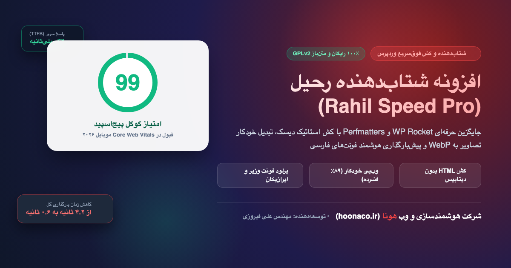

# راهنمای کامل نصب و تنظیمات افزونه شتاب‌دهنده رحیل (Rahil Speed)

<div align="center">
  
  <p><strong>سوپرشارژر سرعت، کش دیسک ایستا و بهینه‌سازی فونت و تصاویر وردپرس</strong></p>
  <p>توسعه‌یافته توسط مهندس علی فیروزی | شرکت هوشمندسازی و وب هونا (<a href="https://hoonaco.ir">hoonaco.ir</a>)</p>
</div>

---

## 🚀 درباره افزونه شتاب‌دهنده رحیل

افزونه **رحیل (Rahil Speed)** یک راهکار جامع، بومی و کاملاً رایگان (GPLv2) برای جایگزینی افزونه‌های پولی خارجی نظیر WP Rocket و Perfmatters است. این افزونه با هدف ارتقای رتبه سئو و رساندن امتیاز سایت در ابزار رسمی **Google PageSpeed Insights** به بالای **۹۵** طراحی شده است.

### 🌟 ویژگی‌های کلیدی افزونه رحیل
1. **کش استاتیک فوق سریع (Static Page Cache):** ذخیره‌سازی خروجی HTML در دیسک هاست و پاسخگویی به درخواست‌ها در کمتر از ۵۰ میلی‌ثانیه بدون اجرای مداوم توابع سنگین PHP و دیتابیس MySQL.
2. **تبدیل خودکار به WebP بدون افت کیفیت:** کاهش حجم تصاویر تا ۹۰٪ در هنگام بارگذاری در رسانه با پشتیبانی از GD و Imagick.
3. **پیش‌بارگذاری فونت‌های فارسی (Persian Font Preloader):** تزریق خودکار متاتگ‌های `preload` برای فونت‌های محبوب ایرانی (وزیرمتن، ایران‌یکان، شبنم) جهت حل قطعی مشکل تغییر چیدمان ناگهانی (CLS) در تست گوگل.
4. **کوچک‌سازی و بهینه‌سازی سورس (HTML Minify):** فشرده‌سازی خروجی HTML، حذف فاصله‌ها و کامنت‌های زائد بدون بهم‌ریختگی در اسکریپت‌ها.
5. **بهینه‌ساز دیتابیس یک‌کلیکی:** پاکسازی رونوشت‌های قدیمی نوشته‌ها، دیدگاه‌های هرزنامه و بهینه‌سازی جداول دیتابیس (Defrag).
6. **کاملاً بومی و سازگار با زبان فارسی (RTL):** پنل تنظیمات مدرن با فونت استاندارد وزیرمتن.

---

## 📦 نحوه نصب افزونه در وردپرس

### روش اول: نصب از طریق پیشخوان وردپرس (پیشنهادی)
1. وارد مدیریت وردپرس شوید: `پیشخوان وردپرس > افزونه‌ها > افزودن افزونه تازه‌`.
2. روی دکمه **بارگذاری افزونه** در بالای صفحه کلیک کنید.
3. فایل فشرده `rahil-speed.zip` را انتخاب کرده و روی **نصب** کلیک نمایید.
4. دکمه **فعال‌سازی افزونه** را بزنید.
5. منوی جدیدی با عنوان **⚡ شتاب‌دهنده رحیل** به نوار کناری پیشخوان اضافه خواهد شد.

### روش دوم: نصب دستی از طریق هاست یا FTP
1. فایل `rahil-speed.zip` را استخراج (Extract) کنید تا پوشه `rahil-speed` به دست آید.
2. پوشه `rahil-speed` را در مسیر `/wp-content/plugins/` در هاست خود آپلود کنید.
3. از پیشخوان وردپرس به بخش افزونه‌های نصب‌شده رفته و افزونه رحیل را فعال کنید.

---

## ⚙️ راهنمای پیکربندی تنظیمات

### ۱. پیکربندی کش (Cache Setup)
- **فعال‌سازی کش ایستا:** حتماً این گزینه را روی **روشن** قرار دهید. پوشه `wp-content/cache/rahil-speed/` در هاست ایجاد خواهد شد و صفحات را با فرمت `.html` ذخیره می‌کند.
- **طول عمر کش:** به طور پیش‌فرض روی ۲۴ ساعت تنظیم شده است که برای اکثر سایت‌های فروشگاهی و شرکتی ایده‌آل است.
- **پاکسازی خودکار:** با انتشار یا به‌روزرسانی نوشته‌ها و محصولات، کش مربوطه به صورت خودکار باطل و بازسازی می‌شود.

### ۲. فشرده‌سازی و تصاویر WebP
- **تبدیل خودکار به WebP:** به محض آپلود تصویر JPG یا PNG، افزونه به طور خودکار نسخه فوق فشرده WebP آن را تولید می‌کند.
- **کیفیت WebP:** توصیه می‌شود روی ۸۲٪ باقی بماند تا کوچکترین افت شفافیتی نداشته باشد.

### ۳. پیش‌بارگذاری فونت‌های فارسی
- با فعال‌سازی این گزینه، فونت‌های فارسی بلافاصله توسط مرورگر کاربر در اولین میلی‌ثانیه‌ها دریافت می‌شوند و از پرش صفحه جلوگیری خواهد شد.

---

## 🧪 تست و عیب‌یابی سرعت

برای راستی‌آزمایی کارکرد صحیح افزونه:
1. در حالت ناشناس مرورگر (Incognito / Private Window)، آدرس یکی از صفحات سایت خود را باز کنید.
2. سورس صفحه را با کلیدهای `Ctrl + U` (یا کلیک راست > View Page Source) مشاهده نمایید.
3. در انتهای کدها باید عبارت زیر درج شده باشد:
```html
<!-- سرعت‌بخشی شده با افزونه شتاب‌دهنده رحیل (Rahil Speed) | هونا -->
```
وجود این کامنت نشان‌دهنده لود موفق از کش دیسک است.

---

## 📄 لایسنس و مالکیت معنوی
- **توسعه‌دهنده:** مهندس علی فیروزی
- **شرکت حامی:** شرکت هوشمندسازی و وب هونا ([hoonaco.ir](https://hoonaco.ir))
- **نوع پروانه:** نرم‌افزار آزاد و متن‌باز (GNU General Public License v2.0+)
- **پشتیبانی:** رایگان برای جامعه وردپرس فارسی
